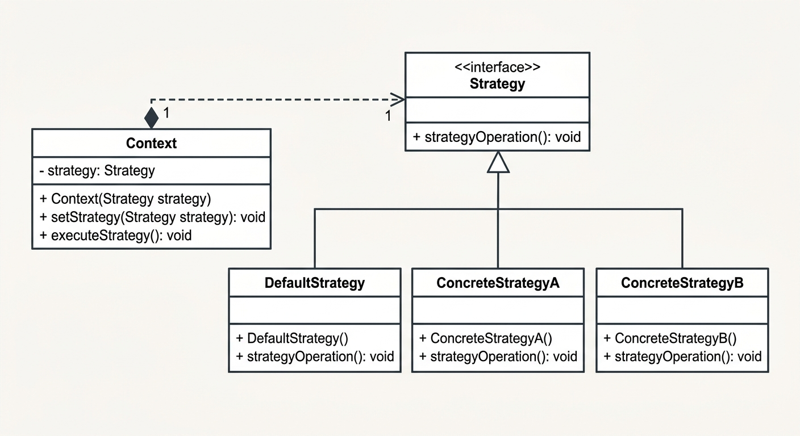

# Strategy Design Pattern (Java)

A lightweight Java implementation of the Strategy Design Pattern, demonstrating how to decouple an algorithm from its hosting context and switch behaviors dynamically at runtime.

---

## Key Features

- Decoupled Architecture: High-level context code depends solely on the Strategy abstraction, not concrete implementations.
- Runtime Flexibility: Swap active algorithms on the fly via setter injection.
- Default Fallback: Built-in DefaultStrategy ensures the context is operational immediately upon instantiation without requiring upfront configuration.
- Extensible: Add new operational behaviors by creating a new class that implements Strategy with zero modifications required in existing code (Open/Closed Principle).

---

## Pattern Structure



1. Strategy (Interface): Declares the common contract (strategyOperation()) shared by all supported algorithms.
2. DefaultStrategy / ConcreteStrategy1 / ConcreteStrategy2 (Concrete Strategies): Implement specific variations of the algorithm.
3. Context (Client interface): Maintains a reference to a Strategy instance and delegates execution to it.

---

## Quick Start

### Prerequisites
- JDK 11+
- Git

### Installation
Clone the repository and navigate into the project folder:

```bash
git clone https://github.com/your-username/strategy-pattern-demo.git
cd strategy-pattern-demo
```

---

## Usage Example

```java
public class Main {
    public static void main(String[] args) {
        // 1. Initialize context using the built-in default strategy
        Context context = new Context();
        context.executeStrategy(); 
        // Output: Executing default strategy behavior.

        // 2. Inject a custom strategy at runtime
        context.setStrategy(new ConcreteStrategy1());
        context.executeStrategy(); 
        // Output: Executing Concrete Strategy 1 algorithm.

        // 3. Switch to another strategy dynamically
        context.setStrategy(new ConcreteStrategy2());
        context.executeStrategy(); 
        // Output: Executing Concrete Strategy 2 algorithm.
    }
}
```

---

## Project Structure

```text
src/main/java/
├── Strategy.java           # The algorithm abstraction
├── DefaultStrategy.java    # Fallback implementation
├── ConcreteStrategy1.java  # First concrete algorithm
├── ConcreteStrategy2.java  # Second concrete algorithm
├── Context.java            # Context class managing strategy execution
└── Main.java               # Execution demo
```

---

## When to Use This Pattern

- Multiple variants of an algorithm: When you have several ways to perform an operation (e.g., payment processing, compression formats, sorting routines).
- Elimination of conditional logic: Replaces long if-else or switch blocks with polymorphism.
- Isolating implementation details: Keeps business logic separated from specific algorithmic steps.

---

## License

Distributed under the MIT License. Feel free to adapt this example for educational or commercial purposes.